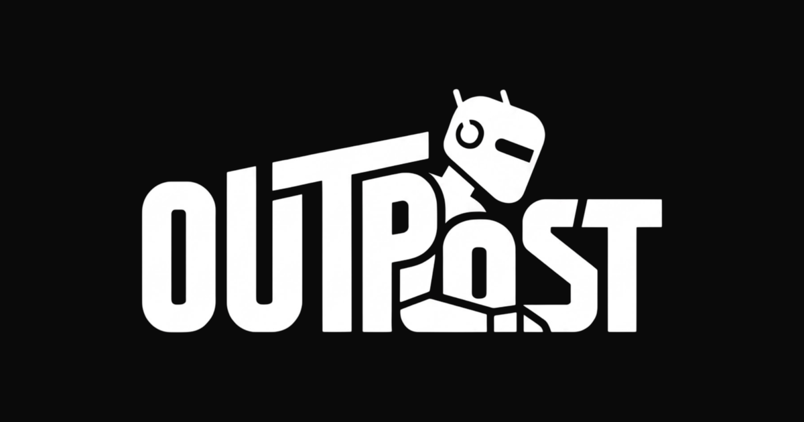
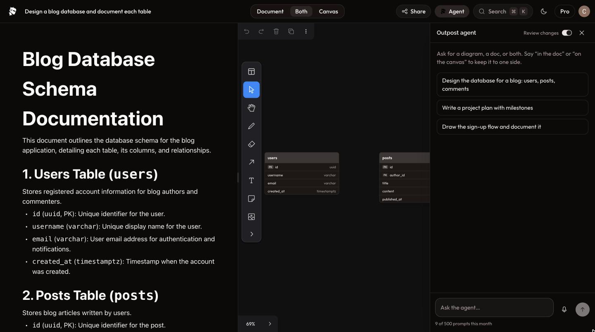

# Outpost

**Docs, a canvas and an AI agent in one real-time workspace.** Plan in a rich-text doc, sketch on an
infinite canvas, and ask the agent to draw the diagram or write the spec. Every change it makes arrives
as a proposal you can accept or reject.

**Live: https://outpost-gray.vercel.app**





## Features

- **Collaborative doc**: a BlockNote editor synced live between everyone in the workspace (Yjs over
  Supabase Realtime), with presence and cursors.
- **Collaborative canvas**: tldraw synced through a Cloudflare Durable Object, plus a custom
  entity-relationship table shape whose arrows snap to individual rows.
- **Workspace agent**: Gemini with tool calling that edits the doc and canvas directly in the browser,
  reads both surfaces to keep them consistent, and streams its reasoning.
- **Review mode**: each agent change is recorded with an exact inverse. Accept or reject changes one by
  one or all at once, jump to a change on the canvas, or undo one later. Edits made by other people
  in the meantime are kept.
- **Teams**: personal workspaces plus Clerk organizations. A team switcher scopes the dashboard, the
  board, access and billing.
- **Plans and limits**: Clerk Billing for subscriptions. Prompt allowances per member are checked before
  the model is called.
- **Sharing**: a public, read-only link per workspace that can be revoked or reset.
- **PDF export**: the doc as selectable text with Cyrillic-capable fonts, the canvas as a page sized to the
  drawing, or both in one file.
- **Board**: a kanban of workspaces by status with drag and drop.
- **English and Russian** throughout, including Clerk's screens, with locale detection and clean URLs.
- **Command palette** (⌘K), light and dark themes, voice input, and a responsive layout for phones.

## Stack

| Area | Choice |
| --- | --- |
| Framework | Next.js 16 (App Router, Cache Components, Server Actions, Turbopack), React 19, TypeScript |
| UI | Tailwind CSS v4, shadcn/ui on Base UI, Hugeicons |
| Auth, teams, billing | Clerk (organizations, Clerk Billing) |
| Database | Supabase Postgres through Prisma 7 (`@prisma/adapter-pg`), with RLS locking the public Data API |
| Real-time | Yjs over Supabase Realtime (doc), `@tldraw/sync` on a Cloudflare Durable Object (canvas) |
| Editors | BlockNote 0.57, tldraw 5 |
| AI | AI SDK 7 with Google Gemini, client-side tool execution |
| PDF | `@blocknote/xl-pdf-exporter`, `@react-pdf/renderer` |
| Tooling | pnpm, ESLint, Vitest, GitHub Actions, Vercel |

## How it works

```
Browser ─────────────────────────────────────────────────────────────────────────────
  BlockNote + Yjs ──── Supabase Realtime channel (RLS: workspace members only) ────┐
  tldraw ───────────── WebSocket ── Cloudflare Worker + Durable Object per canvas  │
                          ▲           (accepts only a signed, room-scoped,          │
                          │            60-second ticket)                            │
  Agent panel ── POST /api/agent ── Gemini streams tool calls ──► run locally on   │
                                                                  the live editors │
Next.js on Vercel ──────────────────────────────────────────────────────────────────┤
  Server Components + Server Actions ── Prisma ── Supabase Postgres ◄──────────────┘
  Clerk: sessions, organizations, plans
```

- **The agent runs its tools in the browser.** The route handler only streams Gemini's tool calls, and
  the client applies each one to the live editor. Edits therefore go through the same real-time sync as a
  person's edits, and the client can capture an exact inverse of each one (a tldraw `RecordsDiff`, or
  the affected blocks for the doc) to power review mode.
- **The canvas server checks no sessions.** After its own access check, the app signs a short-lived
  HMAC ticket for one room. The Worker verifies it with WebCrypto. A contract test runs both
  implementations against each other.
- **Personal or team scope** comes from the active Clerk organization, so the same queries serve both.
  Usage is billed to the workspace's owner, either the team or the person.

## Getting started

Requirements: **Node.js 22** (see `.nvmrc`) and **pnpm**.

```bash
pnpm install                 # also generates the Prisma client
cp .env.example .env.local   # fill in the values (see the comments in the file)
pnpm db:push && pnpm db:rls && pnpm db:realtime
pnpm dev                     # http://localhost:3000
```

The canvas needs the sync Worker. Deploy it from `tldraw-sync/` with `pnpm deploy` after setting the same
`CANVAS_SYNC_SECRET` (`wrangler secret put CANVAS_SYNC_SECRET`). Without it the rest of the app works
and the canvas shows a setup hint.

Services you need: Clerk (enable Organizations with *membership optional*, plus Billing for plans), a
Supabase project, a Cloudflare account (the Worker fits the free tier), a Gemini API key and, for
production, a tldraw license key (free for hobby projects).

## Scripts

| Script | What it does |
| --- | --- |
| `pnpm dev` | Start the dev server |
| `pnpm build` / `pnpm start` | Production build / serve it |
| `pnpm typecheck` | Generate route types, then run TypeScript |
| `pnpm lint` | ESLint |
| `pnpm test` | Unit tests (Vitest) |
| `pnpm db:push` | Sync `prisma/schema.prisma` to the database |
| `pnpm db:rls` | Enable row level security on every table |
| `pnpm db:realtime` | Realtime policies that limit doc channels to workspace members |
| `pnpm db:studio` | Browse the database in Prisma Studio |

## Project structure

```
src/
  app/[lang]/           Every page, under a locale (en, ru)
    (main)/             Signed-in app: dashboard, board, workspace
    shared/[token]/     Public read-only workspace
  app/api/agent/        Agent route: streams Gemini tool calls
  actions/              Server Actions
  components/
    agent/              Agent panel, review-mode state, change cards
    canvas/             tldraw editor, viewer, entity-table shape
    doc/                BlockNote editor and viewer
    workspace/          Panels, view switcher, upgrade dialog
    ui/                 shadcn/ui primitives
  lib/agent/            Tool schemas and how each tool is applied and reverted
  lib/realtime/         Yjs provider over Supabase Realtime
  i18n/                 Dictionaries and locale helpers
  proxy.ts              Locale routing and route protection
tldraw-sync/            Cloudflare Worker for canvas sync
prisma/                 Schema and SQL for RLS and Realtime policies
tests/                  Unit tests
```

## Credits and license

Outpost started as a rebuild of
[piyush-eon/agentic-workspace-saas](https://github.com/piyush-eon/agentic-workspace-saas), which is
licensed under GPL-3.0. It has the same core idea: a doc, a canvas and an agent in one workspace. The
code was written from scratch, with a different design, and adds the following:

- review mode for agent changes;
- English and Russian;
- the ⌘K command palette;
- combined PDF export;
- the ERD shape with row-snapped relationships;
- the Cloudflare-based canvas sync with signed tickets;
- a team switcher.

Outpost is licensed under the [GNU General Public License v3.0](LICENSE).
